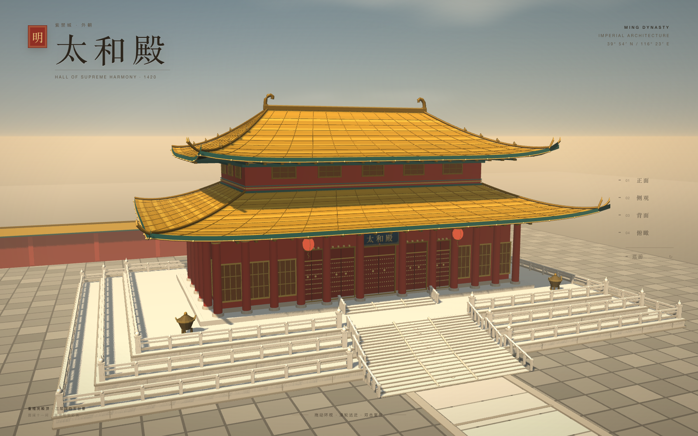

# 明宫三维 · Ming Palace 3D

**DeepSeek Flash 1017 · 单提示词代码生成测试**  
一座在浏览器中自由环视的明代官式宫殿，使用原生 WebGL2 程序化建模与渲染。

> A one-prompt WebGL2 3D Ming palace, generated with DeepSeek Flash 1017. No external libraries, assets, or network requests. Drag to orbit, scroll to zoom, double-click to reset.



**在线预览：** <https://norwinyu.github.io/deepseek-flash-1017-ming-palace/>  

**仓库：** <https://github.com/NorwinYu/deepseek-flash-1017-ming-palace>

---

## 生成测试说明

本项目用于观察 **DeepSeek Flash 1017** 在一次提示词下的代码生成与视觉实现效果。

| 项目 | 内容 |
| --- | --- |
| 模型 | DeepSeek Flash 1017 |
| 方式 | 单次提示词、独立完成 |
| 约束 | 不参考其他文件和网络资料 |
| 产物 | 单文件 `index.html`，含原生 WebGL2 场景与交互 |
| 说明 | 这是一次展示性生成测试，不是标准化 benchmark |

提示词原文：

> 用html和js做一个3D的宫殿，中国明朝建筑风格，可以用鼠标拖动来看这个宫殿不同的侧面。独立完成，不参考其他文件和网络资料

## 项目简介

`deepseek-flash-1017-ming-palace` 是一个零构建、零依赖的单页 3D 场景。宫殿的屋面、台基、栏杆、门窗、斗拱和庭院均由 JavaScript 在运行时生成，不使用外部模型或贴图。

本项目关注的是**明代官式建筑的视觉特征与交互体验**，并非测绘级或考古级的建筑复原。

## 建筑与视觉

- **重檐庑殿顶**：双层曲面屋顶、瓦垄、正脊、垂脊与脊兽
- **三层汉白玉台基**：栏板望柱、丹陛石、三层御路台阶
- **面阔十一间**：红柱、五座金钉朱门、格扇窗、额枋与斗拱
- **细节**：蓝底金字“太和殿”匾额、宫灯、铜鼎、庭院宫墙
- **渲染**：实时平行光阴影、天空渐变、雾化、抗锯齿
- **全程序化**：几何与匾额纹理均在浏览器内生成

| 维度 | 实现 |
| --- | --- |
| 渲染 | 原生 WebGL2 + GLSL ES 3.0 |
| 建模 | JavaScript 程序化生成 |
| 阴影 | 静态深度贴图 + PCF 软阴影 |
| 贴图 | Canvas 2D 生成匾额纹理 |
| 依赖 | 无 |
| 构建步骤 | 无 |

## 操作方式

| 操作 | 效果 |
| --- | --- |
| 鼠标拖动 / 单指拖动 | 360° 环视宫殿侧面 |
| 滚轮 / 双指捏合 | 拉近、拉远 |
| 双击 | 复位初始视角 |
| 右侧“正面 / 侧观 / 背面 / 俯瞰” | 快速切换预设视角 |
| “巡游”按钮 | 开启或暂停自动环绕 |
| 键盘方向键 | 旋转与俯仰 |
| 空格 | 暂停 / 继续巡游 |
| `R` | 复位 |

移动端支持单指旋转、双指缩放，布局会自动适配竖屏。

## 本地运行

无需安装依赖。在项目目录中启动任意静态文件服务器：

```bash
cd deepseek-flash-1017-ming-palace
python3 -m http.server 8000
```

然后打开 <http://localhost:8000>。

也可以直接双击 `index.html`；使用静态服务器可获得更接近 GitHub Pages 的运行环境。

## 部署到 GitHub Pages

### 1. 新建仓库

在 GitHub 新建一个公开仓库，建议命名为：

```text
deepseek-flash-1017-ming-palace
```

不要从工作区根目录提交文件。先进入本项目目录：

```bash
cd deepseek-flash-1017-ming-palace
```

### 2. 初始化并推送

```bash
git init
git add .
git commit -m "feat: add DeepSeek Flash 1017 Ming palace 3D scene"
git branch -M main
git remote add origin https://github.com/NorwinYu/deepseek-flash-1017-ming-palace.git
git push -u origin main
```

### 3. 开启 Pages

在仓库页面进入：

```text
Settings → Pages → Build and deployment
```

选择：

- **Source:** Deploy from a branch
- **Branch:** `main`
- **Folder:** `/ (root)`

保存后等待一两分钟，即可访问：

```text
https://norwinyu.github.io/deepseek-flash-1017-ming-palace/
```

项目已包含 `.nojekyll`，无需 Jekyll 或构建流程。

## 项目结构

```text
.
├── index.html      # 单文件 3D 场景（HTML / CSS / JS）
├── preview.png     # 项目预览图（场景渲染，无个人信息）
├── favicon.svg     # 站点图标
├── README.md
├── .nojekyll       # GitHub Pages：跳过 Jekyll
└── .gitignore
```

## 隐私与素材

- 仓库中不包含作者姓名、邮箱、社交账号或本地文件路径。
- 页面不加载外部字体、图片、统计脚本或 CDN 资源；运行期间不发起第三方网络请求。
- `preview.png` 是项目场景的渲染截图，已移除图片元数据，不含人物或个人信息。
- Git 提交作者信息由提交者本地 Git 配置决定。若不希望公开邮箱，可在 GitHub 账户设置中开启 **Keep my email addresses private**，并使用 GitHub 提供的 `noreply` 邮箱提交。

## 浏览器支持

需要支持 WebGL2 的现代浏览器：

- Chrome / Edge 90+
- Safari 15+
- Firefox 90+

如果设备不支持 WebGL2，页面会显示明确的错误提示。

## 技术细节

- 主场景以一次大网格绘制完成，阴影贴图仅烘焙一次，适合静态建筑场景。
- 相机使用带阻尼的球面轨道控制，支持鼠标、触控与键盘。
- 设备像素比上限为 2，以兼顾高分屏清晰度与移动端性能。
- 可通过查询参数快速进入指定视角：

```text
?view=front | side | back | aerial
?still=1
```

`?still=1` 会关闭自动巡游，适合截图或演示。

## GitHub 仓库设置建议

- **Description：** `A one-prompt WebGL2 3D Ming palace generated by DeepSeek Flash 1017, with no external libraries or assets.`
- **Website：** `https://norwinyu.github.io/deepseek-flash-1017-ming-palace/`
- **Topics：** `deepseek`, `deepseek-flash`, `prompt-test`, `webgl2`, `javascript`, `3d`, `chinese-architecture`, `forbidden-city`, `taihe-hall`, `procedural-generation`, `github-pages`
- **Social preview：** 上传 `preview.png`

---

用原生 JavaScript 与 WebGL2 构建。建筑的每一根柱子、每一片瓦垄，都在代码里。
